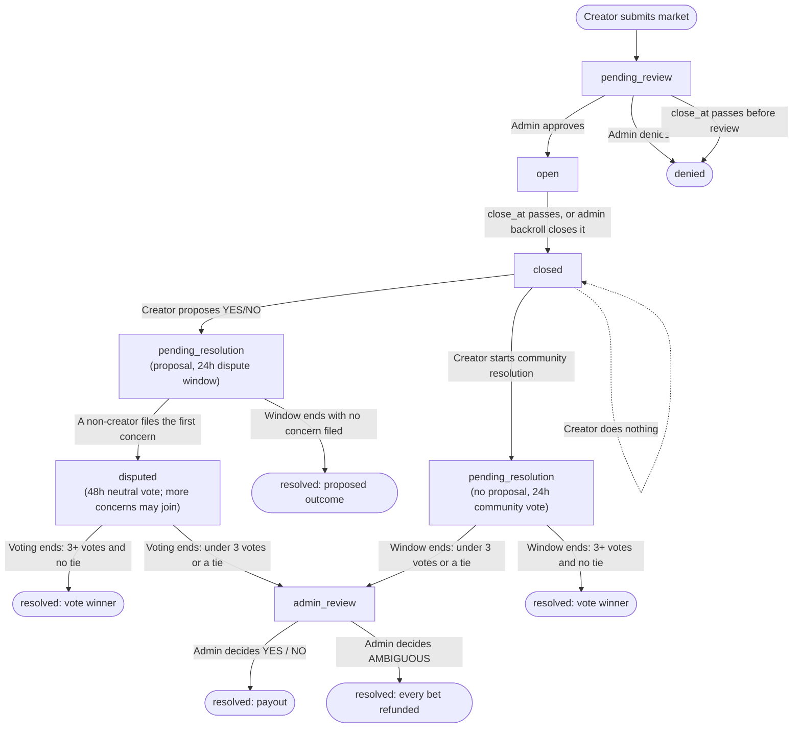

# Market lifecycle

How a market moves through its statuses, and where each status appears in the
admin panel. Source of truth: `backend/services/market_state_machine.py` (timed
transitions) and the resolution functions in `supabase/migrations/`.

Timed transitions are lazy. They run when a market is read through the API,
not on a schedule, so a market can sit past a deadline until someone loads it.

## Decision tree

A closed market whose creator never acts stays `closed`. The state machine
has no timeout for it; admins can only send reminders
(`POST /api/admin/markets/resolution-reminders/run`).

## Where each status appears for admins

| Status | Admin panel location | Admin action available |
| --- | --- | --- |
| `pending_review` | `/admin/review`, **Pending Review** | Approve or deny |
| `denied` | `/admin/review`, **Denied** (latest 50) | None |
| `open` | `/admin/review`, **Approved** (latest 50, only while still `open`) | Backroll panel on the market page |
| `closed` | No queue | Backroll panel on the market page; resolution reminders |
| `pending_resolution` | No queue | Backroll panel on the market page |
| `disputed` | `/admin/disputes`, **Voting open** | Read concerns and tallies; vote like any neutral user; backroll |
| `admin_review` (from a dispute) | `/admin/admin-review` (settle here) and `/admin/disputes`, **Awaiting admin** | Resolve YES, NO or AMBIGUOUS |
| `admin_review` (from community resolution) | `/admin/admin-review` only, since there is no dispute case | Resolve YES, NO or AMBIGUOUS |
| `resolved` | No queue | None (backroll refuses resolved markets) |

`/admin/stats` counts markets in every status.

Notes:

- **Approved list:** a market leaves the **Approved** list as soon as it closes.
  The list is not a full approval history.
- **Backroll:** available to admins on the market page for any status except
  `resolved`. It refunds bets placed after a cutoff and, by default, moves the
  market to `closed` with the cutoff as its close time.
- **Dispute voting:** the creator and anyone who bet on the market, including
  refunded bettors, cannot vote. Anyone except the creator can file one
  concern. See [AUTHZ_MATRIX.md](AUTHZ_MATRIX.md).
